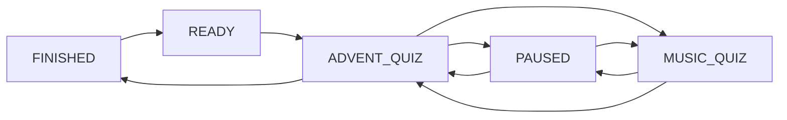
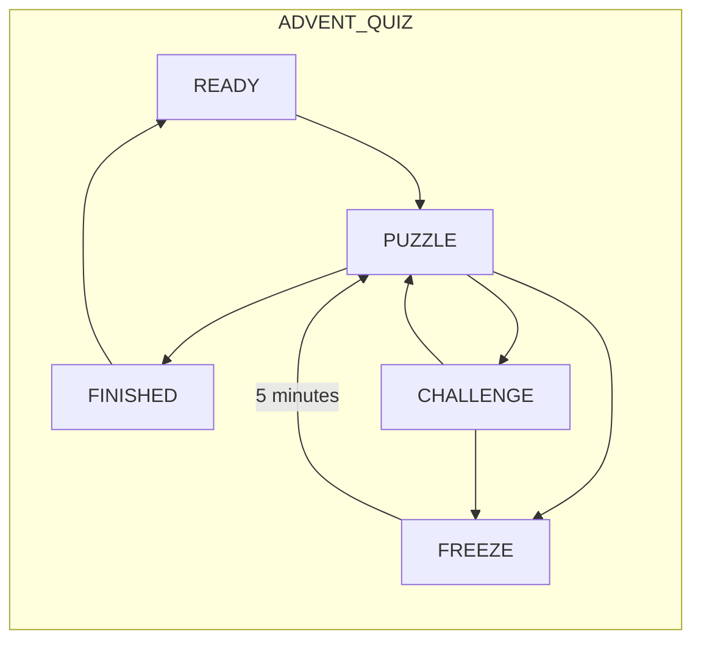

# Game States

This is supporting state documentation. The later approved decisions in `docs/product-decisions.md` and normative rules in `christmas-2026-game-rules-state-semantics.md` take precedence over older wording. The approved presentation of Pause, Freeze, first victory and the final result is in `docs/ui/midnight-advent.md`.

## General Quiz State

Should be mainly influenced by the administrators of the game. Giving them the ability to start/pause/reset the game. The global `FINISHED` state occurs **only after both teams complete puzzle 25**; the first team to finish enters its own terminal team state and is celebrated while the other team continues.

> Global states such as PAUSED and MUSIC_QUIZ temporarily suspend team gameplay but do not replace or mutate the underlying team activity state. When the global state ends, each team resumes from exactly the state it occupied before the interruption.

> `READY` is the application-level state in which no game is actively being played. The implementation does not need a persisted active `Run` row merely to represent `READY`. After a full Reset there should be no active run; administrators select a package and Start creates a new run. A browser/application/Docker/server restart is not a state transition and must recover an existing active run when one exists.

|State  | Description   |
|---    |---            |
|**Ready**| No active game is being played. Administrators can choose an available game package and start a new run. Teams wait for the game master.|
|**Advent Quiz**| This is the normal puzzle / quiz game. Team states during this period are described below.|
|**Paused**| Should only be triggerable by an admin. Essentially pauses all gameplay and moves to a special state. No interactions are possible. When leaving this state everything should be returned to as it was before entering this state. E.g. if a team was in the 3rd minute of waiting out a 5 minute freeze, when they return they should only have to wait 2 minutes.|
|**Music Quiz**| The Music Quiz begins immediately when either team completes puzzle 13. The other team's current Advent Quiz state is suspended regardless of its current puzzle. This is a seperate gamemode, no interactables or quiz progression can be made here. There are some "points" that can be earned. All gameplay timers, including Freeze timers, are suspended while the global game is in **Music Quiz**. The later issue-#44 refinement begins this global state with a 60-second Music gathering subphase before question 1.|
|**Finished**| Global `FINISHED` begins when **both** teams complete puzzle 25. The first finisher is recorded immediately but does **not** end the global race; only an authorized Game Master can Reset to `READY`. |

## Team Activity States

Each team will have this own **Activity State**. This state will mainly govern how that specific team can interact with the quiz game.

> Team `READY` describes the non-playing/waiting condition before a new run starts. It does not require durable per-team rows when no active run exists. Starting a selected package initializes the participating teams for the new run.

> All gameplay timers are authoritative on the backend. Clients may display countdowns, but must never determine whether a timer has expired. Timers must survive browser refreshes, client disconnects, and application restarts.

> All gameplay timers, including Freeze timers, are suspended while the global game is in Paused or Music Quiz. Their remaining duration is preserved and continues when normal Advent Quiz gameplay resumes.

> Music gathering is a subphase of **Music Quiz**, not another global state. Its sequence is `gathering` → questions 1–11 → final results. It uses the existing Music clock, so Pause freezes its remaining time and recovery does not restart it. Question 1 is hidden and cannot be answered during gathering; questions 2–11 begin immediately after the previous winner.

|State  | Description   |
|---    |---            |
|**Ready**| Not able to open advent boxes yet. Before a run exists this is a waiting condition; Start initializes the team's durable run state and moves it to **Puzzle**.|
|**Puzzle**| Normal quiz progression, advent boxes are interactable, answers can be submitted, powerups can be bought, essentially all functionality is available|
|**Challenge**| Both teams join the same Challenge puzzle after the server-authoritative 30-second gathering period. The initiator spends its once-per-game opportunity **for free**. No shop or Advent progression is available during the Challenge. The first server-accepted correct answer wins; only an initiator win freezes the challenged team on return to Advent. |
|**Freeze**| Not able to interact with the game at all, essentially a pause button for a single team. No shop, no advent boxes. After 5 minutes you will return to the **Puzzle** state|
|**Finished**| This **team** has completed puzzle 25 and cannot perform further gameplay actions. The other team remains playable until it also completes puzzle 25. The Game Master may use only supported administrative recovery/Reset commands. |
