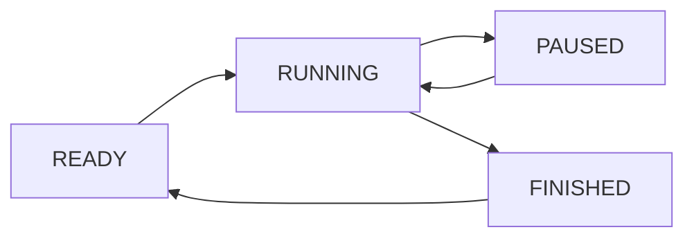
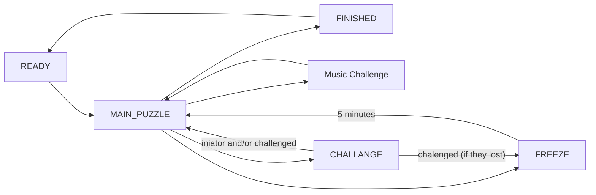

# Game States

This document is used to describe the general game states. This is needed to guide things in the correct direction.

## General Quiz State

Should be mainly influenced by the administrators of the game. Giving them the ability to start/pause/reset the game. The end state can be inferred automatically, when one team finished all questions.

> The General Quiz State takes precedence over Team Activity States. When the general quiz is PAUSED, no team may interact with the game, regardless of its Activity State. When the general quiz resumes, each team returns to its previous Activity State unless an explicit state transition occurred during the pause.

## Team Activity States

Each team will have this own **Activity State**. This state will mainly govern how that specific team can interact with the quiz game.

|State  | Description   |
|---    |---            |
|**Ready**| Not able to open advent boxes yet, purely an initial state before the game can start.|
|**Main_Puzzle**| Normal quiz progression, advent boxes are interactable, answers can be submitted, powerups can be bought, essentially all functionality is available|
|**Challenge**| Only functionality needed for the challenge is active, no main game progression can be made during this time. Also no shop interactions. Only the puzzle interactions for the challaenge. If the challenged team loses the puzzle they move to the freeze state. |
|**Freeze**| Not able to interact with the game at all, essentially a pause button for a single team. No shop, no advent boxes.|
|**Finished**| When the last puzzle had been reached the team reaches the finished state. They are unable to move from this state back to the **Ready** state, only administrators should be allowed to perform this. | 