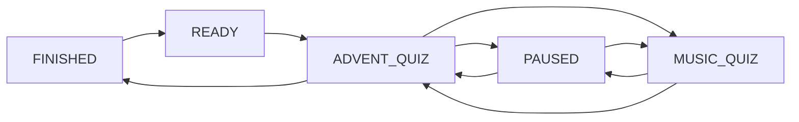
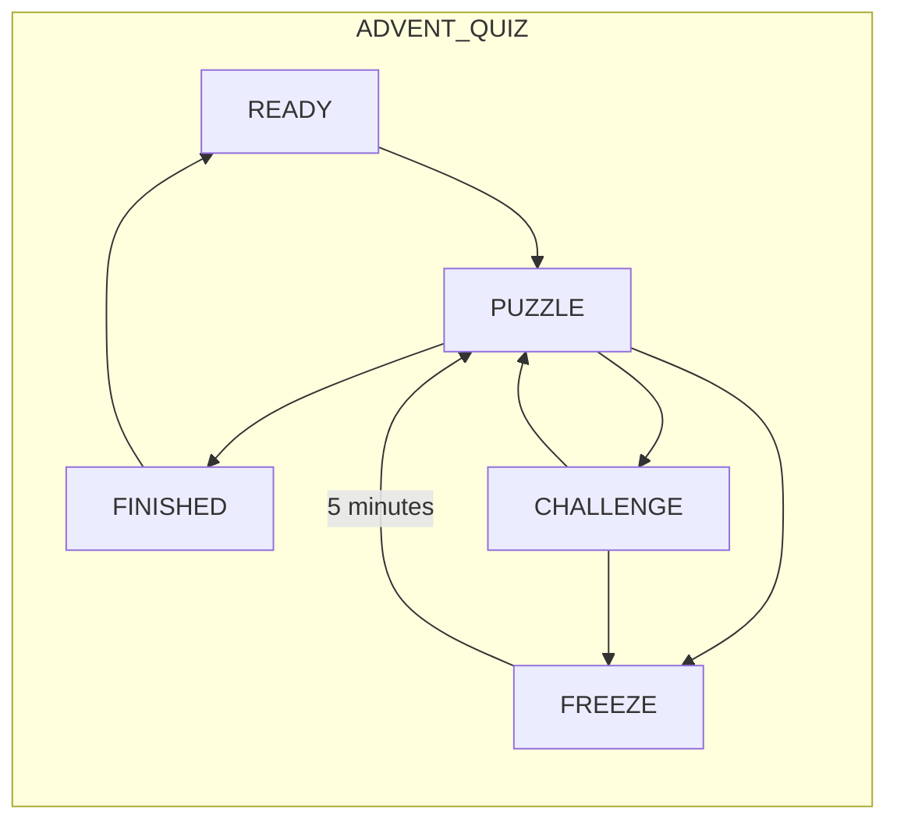

# Game States

This document is used to describe the general game states. This is needed to guide things in the correct direction.

## General Quiz State

Should be mainly influenced by the administrators of the game. Giving them the ability to start/pause/reset the game. The end state can be inferred automatically, when one team finished all questions.

> Global states such as PAUSED and MUSIC_QUIZ temporarily suspend team gameplay but do not replace or mutate the underlying team activity state. When the global state ends, each team resumes from exactly the state it occupied before the interruption.

> `READY` is the application-level state in which no game is actively being played. The implementation does not need a persisted active `Run` row merely to represent `READY`. After a full Reset there should be no active run; administrators select a package and Start creates a new run. A browser/application/Docker/server restart is not a state transition and must recover an existing active run when one exists.

|State  | Description   |
|---    |---            |
|**Ready**| No active game is being played. Administrators can choose an available game package and start a new run. Teams wait for the game master.|
|**Advent Quiz**| This is the normal puzzle / quiz game. Team states during this period are described below.|
|**Paused**| Should only be triggerable by an admin. Essentially pauses all gameplay and moves to a special state. No interactions are possible. When leaving this state everything should be returned to as it was before entering this state. E.g. if a team was in the 3rd minute of waiting out a 5 minute freeze, when they return they should only have to wait 2 minutes.|
|**Music Quiz**| The Music Quiz begins immediately when either team completes puzzle 13. The other team's current Advent Quiz state is suspended regardless of its current puzzle. This is a seperate gamemode, no interactables or quiz progression can be made here. There are some "points" that can be earned. All gameplay timers, including Freeze timers, are suspended while the global game is in **Music Quiz**|
|**Finished**| When the last puzzle had been reached the team reaches the finished state. They are unable to move from this state back to the **Ready** state, only administrators should be allowed to perform this. |

## Team Activity States

Each team will have this own **Activity State**. This state will mainly govern how that specific team can interact with the quiz game.

> Team `READY` describes the non-playing/waiting condition before a new run starts. It does not require durable per-team rows when no active run exists. Starting a selected package initializes the participating teams for the new run.

> All gameplay timers are authoritative on the backend. Clients may display countdowns, but must never determine whether a timer has expired. Timers must survive browser refreshes, client disconnects, and application restarts.

> All gameplay timers, including Freeze timers, are suspended while the global game is in Paused or Music Quiz. Their remaining duration is preserved and continues when normal Advent Quiz gameplay resumes.

|State  | Description   |
|---    |---            |
|**Ready**| Not able to open advent boxes yet. Before a run exists this is a waiting condition; Start initializes the team's durable run state and moves it to **Puzzle**.|
|**Puzzle**| Normal quiz progression, advent boxes are interactable, answers can be submitted, powerups can be bought, essentially all functionality is available|
|**Challenge**| Only functionality needed for the challenge is active, no main game progression can be made during this time. Also no shop interactions. Only the puzzle interactions for the challaenge. If the challenged team loses the puzzle they move to the freeze state. |
|**Freeze**| Not able to interact with the game at all, essentially a pause button for a single team. No shop, no advent boxes. After 5 minutes you will return to the **Puzzle** state|
|**Finished**| When the last puzzle had been reached the team reaches the finished state. They are unable to move from this state back to the **Ready** state, only administrators should be allowed to perform this. |
