# Christmas Escape Room Quiz — Game Rules & State Semantics

> Normative rules for the game-state engine. This document is intended as a **plugin/specification alongside the main application specification**, not as a replacement for it.
>
> **Current precedence (2026-10-11):** Later explicit approvals in `docs/product-decisions.md` override the older conflicting descriptions **only where specified**: in particular Challenge is **free**, there is a distinct puzzle per initiating team, both teams answer the same puzzle within a Challenge, a 15-second gathering phase comes first, the public TV may display the shared Challenge question during the active phase, player Skip on puzzle 25 is forbidden, and the Music display rules are refined. Other authoritative gameplay, privacy, clock, recovery and concurrency rules here continue to apply. See `docs/ui/midnight-advent.md` for presentation and `docs/ui/midnight-advent-rollout.md` for the redesign ticket route.

## 1. Normative language

- **MUST** — mandatory behaviour.
- **MUST NOT** — forbidden behaviour.
- **SHOULD** — recommended unless there is a documented reason not to.
- **MAY** — optional.

The backend is authoritative. The frontend MUST NOT be trusted to enforce game rules.

---

## 2. Two-layer state model

The game has two independent state layers:

1. **Global Quiz State**
2. **Team Activity State**, one for each team

Global `PAUSED` and `MUSIC_QUIZ` are interruptions/overlays. They MUST NOT replace or destroy the underlying team states.

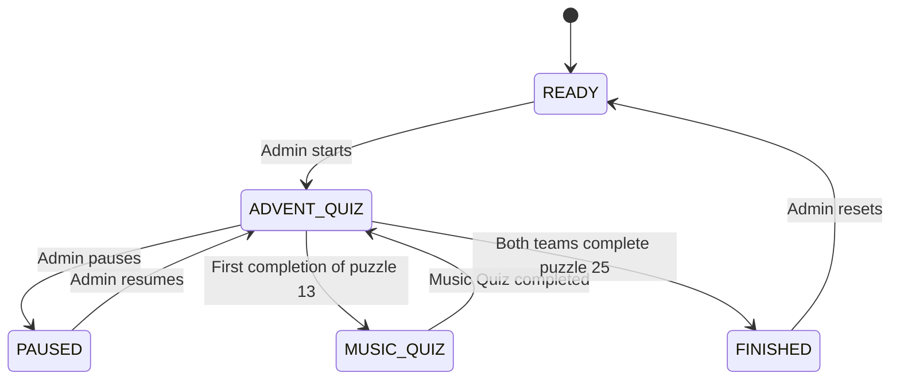

Example during an interruption:

```text
Before:
Global = ADVENT_QUIZ
Team A = PUZZLE
Team B = FREEZE, 03:12 remaining

During Music Quiz:
Global = MUSIC_QUIZ
Team A = PUZZLE
Team B = FREEZE, 03:12 remaining

After:
Global = ADVENT_QUIZ
Team A = PUZZLE
Team B = FREEZE, 03:12 remaining
```

---

# 3. Global Quiz State

Canonical states:

- `READY`
- `ADVENT_QUIZ`
- `PAUSED`
- `MUSIC_QUIZ`
- `FINISHED`

### READY

- Initial state and the state after an administrator fully resets/ends the active game.
- No gameplay interaction is available.
- No game run needs to be active merely to represent `READY`.
- Both teams are conceptually `READY` and receive only a waiting-for-game-master view.
- Administrators may inspect the available game packages and select which package to start.
- Inspecting/listing packages MUST NOT itself create a run or immutable run snapshot.
- Start validates the selected current source package, creates a new immutable configuration/media snapshot, creates a new active run, and changes the global state to `ADVENT_QUIZ` with both teams on their first `PUZZLE`.
- A process, application, container, host, browser, or network restart is not a transition to `READY`. If an active run exists, it MUST be recovered instead of replaced or reloaded from source configuration.

### ADVENT_QUIZ

Normal gameplay. Team actions are allowed only when their own state and the game rules permit them.

### PAUSED

When paused:

- all gameplay interaction is disabled;
- all gameplay timers/effects stop;
- shop purchases are disabled;
- attacks are disabled;
- challenges cannot be initiated;
- puzzle answers cannot be submitted.

Resuming restores the exact underlying team states and timer values.

### MUSIC_QUIZ

The Music Quiz is a one-time global mini-game.

When active:

- normal Advent gameplay is suspended;
- underlying team states are preserved;
- all gameplay timers/effects pause;
- shop purchases, attacks and Challenges are disabled;
- normal puzzle answers are disabled.

After completion, the exact previous team states resume.

The Music Quiz triggers immediately when **any team completes puzzle 13**. Normal completion, Skip and admin force completion all count. The trigger occurs only once per game; reopening/recompleting puzzle 13 does not trigger it again.

The trigger begins a 60-second `gathering` subphase on the existing Music clock. Advent is already suspended throughout gathering, and neither team can see or answer question 1 until 60,000 active Music milliseconds have elapsed. Pause freezes gathering; recovery and active downtime follow the existing Music-clock policy. The Music sequence is `gathering` → question 1 → questions 2–11 → final results; gathering is not a separate global state.

It has 11 questions. For each question:

- both teams may submit answers;
- attempts are unlimited;
- wrong answers have no penalty;
- there is no time limit;
- the first valid correct answer accepted by the server wins;
- later answers are rejected because the question is already resolved;
- after a winner, the next question starts immediately (questions 2–11).

The correct team receives a globally configured number of points, added directly to its normal point balance.

Music questions have no countdown or deadline. The shared TV may show the issue-#44 cosmetic player-style bar on a fixed three-minute scale without visible endpoint labels; it does not use track duration or playback position and has no effect on question timing.

After question 11, show the final score for a configurable duration (approximately 1–3 minutes by default), then return to Advent Quiz.

Music Quiz scores may be visible to both teams.

### FINISHED

The global game becomes `FINISHED` **only after both teams have completed puzzle 25**.

The first team to complete puzzle 25:

- immediately receives the winner/confetti presentation;
- remains on that presentation for the rest of the game;
- cannot initiate or receive attacks;
- cannot initiate or participate in Challenges;
- cannot otherwise perform gameplay actions.

The other team receives an indication that the first team finished and continues normally.

Only the second team finishing causes the global game to enter `FINISHED`.

Only an admin can reset `FINISHED` to `READY`.

---

# 4. Team Activity State

Canonical states:

- `READY`
- `PUZZLE`
- `FREEZE`
- `CHALLENGE`
- `FINISHED`

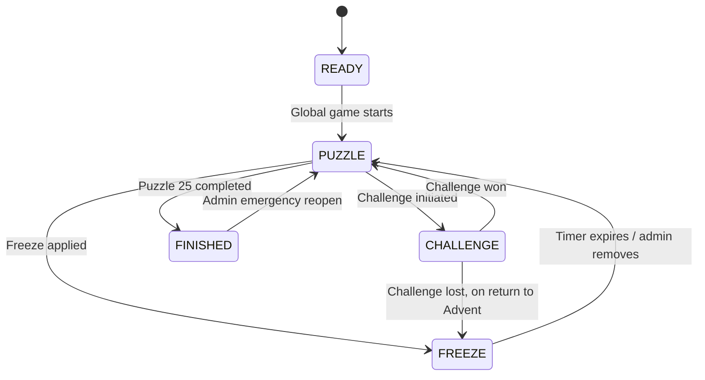

## PUZZLE

Normal team gameplay.

The team may:

- view its current puzzle;
- submit answers;
- use Hint tokens;
- buy permitted shop items;
- initiate a Freeze attack;
- initiate a Challenge if eligible.

## FREEZE

A frozen team:

- cannot view its current puzzle;
- cannot view/use hints;
- cannot submit answers;
- cannot use the shop;
- cannot attack;
- cannot initiate a Challenge.

Freeze lasts **5 minutes of Advent gameplay time**, not wall-clock time.

Freeze timers pause during global `PAUSED` and `MUSIC_QUIZ`.

There is only one active Freeze per team.

Admin removal immediately returns the team to `PUZZLE`; there is no remaining timer.

“Freeze a team” and “trigger a Freeze effect” are the same canonical mechanic.

## CHALLENGE

During a Challenge:

- each initiating team has a **different** package-authored Challenge puzzle; across one Challenge both teams receive the **same selected puzzle**;
- there is a **15-second server-authoritative gathering phase** before puzzle and answer controls become available; Pause suspends that countdown;
- attempts are unlimited;
- there is no time limit;
- wrong answers have no penalty;
- first server-accepted correct answer wins;
- Advent progression is unaffected;
- shop and attacks are disabled for both teams.

The Challenge stores initiator, challenged team, puzzle, status and result.

If the **initiator wins**, the challenged team receives a Freeze when the game returns to Advent. Neither team gets points.

If the **challenged team wins**, both return to normal Advent activity and no Freeze is applied.

A Challenge opportunity is consumed at initiation.

Disconnecting does not cause a loss. The Challenge continues until resolved.

Admins may cancel a Challenge as an emergency operation. Cancellation restores the initiator's opportunity; Challenge costs **zero points**, so there is **no positive points refund**. This is a low-priority emergency feature, not a command to invent during the current UI redesign.

## FINISHED

A team becomes `FINISHED` after completing puzzle 25. It cannot perform normal gameplay actions.

An admin may reopen a finished team as an emergency feature.

---

# 5. Sequential progression

Normal progression is strictly sequential.

To legitimately progress to puzzle `N`, every puzzle from `1` through `N-1` must be completed.

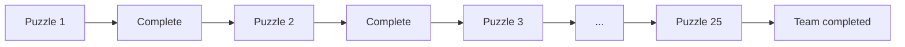

The backend MUST enforce prerequisites.

Use **completed** consistently. Avoid treating “solved”, “finished”, “unlocked” and “skipped” as separate completion states.

---

# 6. Canonical puzzle completion

There are three completion routes in general:

1. Correct answer.
2. Player Skip.
3. Admin force completion.

**Puzzle 25 is the explicit exception to route 2.** A player Skip request targeting the authoritative current puzzle 25 MUST be rejected before cost deduction and before entering canonical completion. Correct-answer and administrator force-completion routes remain valid on puzzle 25.

All accepted completion routes use the same completion pipeline:

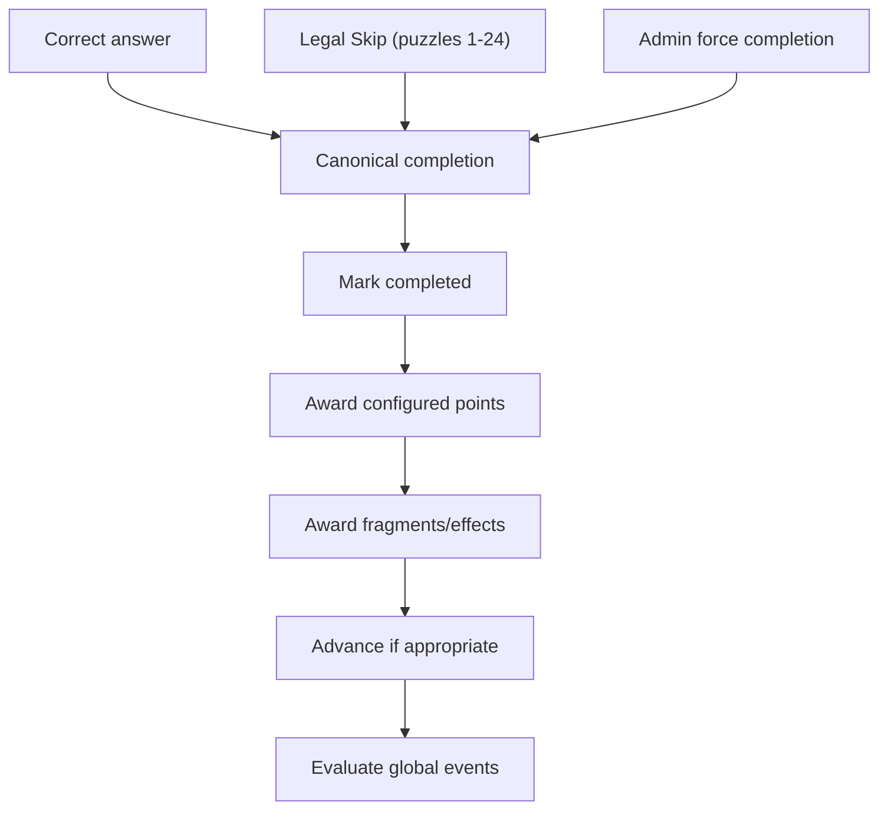

Completion may:

- mark the puzzle completed;
- award its configured point/coin reward;
- award configured fragments/information;
- apply configured completion effects;
- advance the team;
- trigger global events such as the one-time Music Quiz.

A legal Skip on puzzles 1–24 counts as successful completion.

Admin force completion counts as successful completion, including on puzzle 25.

Standard puzzles normally award a configurable amount of points/coins.

## Re-completion

A puzzle may be completed again after admin reopening.

A repeated completion MUST NOT duplicate completion rewards or fragments already awarded for that puzzle.

The implementation should distinguish the current completion status from historical completion/reward events.

If puzzle 25 becomes current again after administrative reopening/recovery, player Skip remains illegal; reopening does not make the final puzzle skippable.

---

# 7. Admin reopening and prerequisite violations

Reopening an earlier puzzle is a niche emergency feature.

Example:

```text
Current puzzle = 11
Admin reopens puzzle 8

Current puzzle remains = 11
Puzzle 8 becomes incomplete
```

This creates a prerequisite violation. The team must complete puzzle 8 again before it can legitimately continue normal progression that depends on puzzle 8.

There is **no automatic rollback** of later progression, points or fragments.

If an admin force-completes an earlier puzzle while the team is further ahead:

- that puzzle becomes completed;
- configured completion behaviour is applied, subject to duplicate-reward rules;
- the current position remains unchanged;
- later progression is not rolled back.

Admin force-completing the current puzzle uses the normal completion pipeline and advances normally.

---

# 8. Hints

Hints are generic inventory tokens, not puzzle-specific inventory.

### Purchase

A Hint purchase:

- costs the configured Hint price;
- atomically deducts points;
- adds one Hint token.

Insufficient points reject the transaction.

### Use

Using a Hint:

1. checks that the team has a token;
2. checks that the team may interact with its current puzzle;
3. consumes one token;
4. reveals the configured hint.

Hints may be used on any current puzzle, including after wrong attempts.

Unused Hint tokens persist across puzzle progression.

### Admin hint

An admin-provided hint immediately reveals the hint and does not consume a token.

---

# 9. Skips

A Skip is not a persistent puzzle-specific item.

It is an action that completes the current puzzle **only for puzzles 1–24**. Puzzle 25 MUST reject player Skip authoritatively, including direct, stale, reconnect, and reopened-final-puzzle requests.

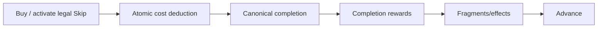

A legal Skip on puzzles 1–24:

- cannot make points negative;
- counts as completion;
- awards the same configured completion rewards as a normal answer;
- awards fragments;
- may trigger completion events;
- triggers the Music Quiz when completing puzzle 13 if it has not happened yet.

For puzzle 25, rejection MUST occur before any point deduction, completion/reward/fragment/effect write, first-finisher transition, winner transition, global `FINISHED` transition, or successful Skip/completion audit event.

---

# 10. Points / coins

Points are persistent team state.

All costs and rewards are globally configurable, including:

- puzzle completion rewards;
- Hint cost;
- Skip cost;
- Freeze cost;
- Uno Reverse cost;
- Challenge cost (**fixed at zero** for the supported game package; not a purchasable/affordability condition);
- Music Quiz question reward;
- initial points.

A team's balance MUST never become negative.

Insufficient funds cause the action to be rejected with no partial state change.

Purchases MUST be atomic. Simultaneous requests must not be able to spend the same points twice.

---

# 11. Freeze attack

A team may spend points to freeze the opposing team when permitted.

Requirements:

- attacker is in `PUZZLE`;
- target is not already frozen;
- target is not `FINISHED`;
- global state is `ADVENT_QUIZ`;
- attacker has enough points;
- attacker pays the configured cost;
- successful cost is not refunded.

The target receives a 5-minute Advent-gameplay-time Freeze.

## Uno Reverse

If the target has an active Uno Reverse:

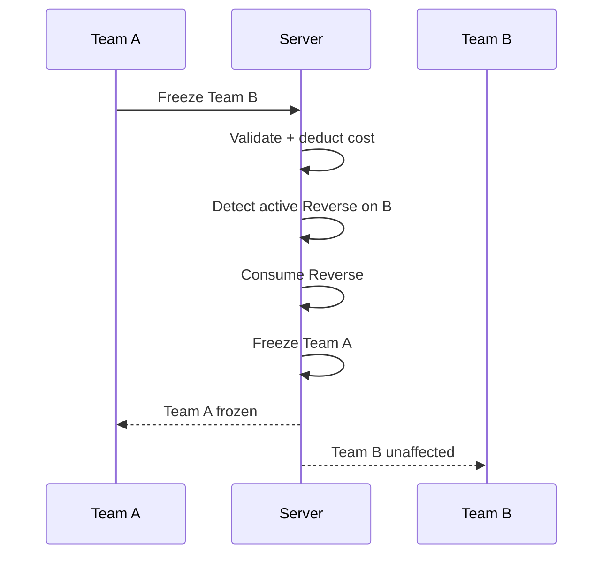

The attacker still pays. There is no refund.

The Reverse is consumed.

The target is unaffected.

Only one Uno Reverse can be active.

An active Uno Reverse remains active indefinitely until triggered or removed.

---

# 12. Challenge rules

Each team has exactly one Challenge opportunity per game.

A Challenge may be initiated only when:

- initiating team is in `PUZZLE`;
- opposing team is not frozen;
- neither team is finished;
- global state is `ADVENT_QUIZ`;
- the initiating team still has its Challenge opportunity;
- a separate Challenge puzzle for that initiating team exists in the snapshotted package.

Challenge is **free**, so points and affordability are **not** eligibility conditions.

Initiation atomically:

1. consumes the **single free opportunity** of the initiator without deducting points;
2. selects the initiator's **distinct** snapshotted Challenge puzzle and records the Challenge;
3. begins a **15-second gathering period**, with question/media/answer unavailable until that period expires on the server.

Both teams then participate in **the same selected Challenge puzzle**. Up to two Challenges can occur in one run, with no reused question identity.

First valid server-accepted correct answer wins.

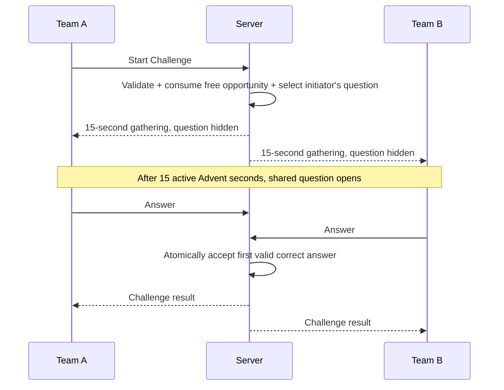

The winner receives no points.

If the initiator wins, the challenged team gets a Freeze on return to Advent.

The Challenge has no effect on Advent puzzle progression.

---

# 13. Global interruption semantics

Both `PAUSED` and `MUSIC_QUIZ` preserve team state.

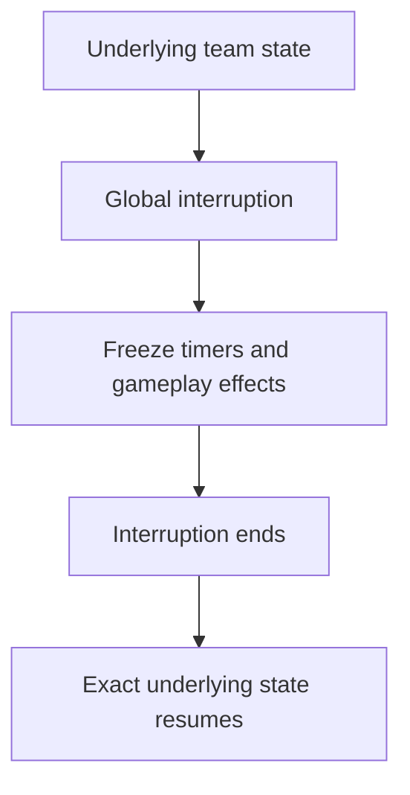

All gameplay timers/effects pause during both interruptions.

This includes Freeze timers.

Wall-clock event timestamps continue normally.

---

# 14. Timer semantics

Timers MUST be authoritative on the server.

The frontend may display a countdown but must not own the authoritative timer.

Prefer modelling timers using authoritative timestamps and/or accumulated gameplay duration.

Conceptually:

```text
Freeze starts
    ↓
5:00 gameplay duration
    ↓
Global PAUSED
    ↓
remaining duration unchanged
    ↓
Global ADVENT_QUIZ
    ↓
countdown resumes
    ↓
0:00
    ↓
Freeze expires
```

The logical state should survive browser refresh, reconnect and server restart.

Exact server-restart implementation is secondary to the requirement that the logical state is recoverable.

---

# 15. Authentication and team isolation

There is one supported team device per team in the current version.

Each team has a configurable login/PIN.

The backend MUST enforce team isolation for every team-specific read and write.

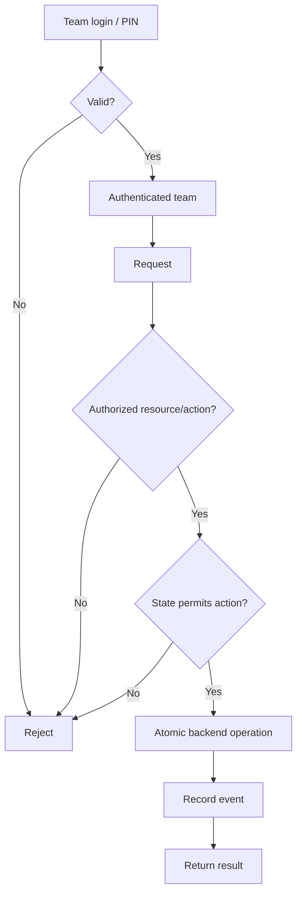

Team A MUST NOT be able to access Team B by:

- URL manipulation;
- API parameter manipulation;
- frontend state manipulation;
- direct requests;
- any equivalent client-side bypass.

Team-specific state includes puzzles, attempts, progression, points, effects, hints, fragments and other private data.

Music Quiz scores are the explicit shared-information exception.

---

# 16. Concurrent requests

The backend must correctly resolve simultaneous valid requests.

Important examples:

- Music Quiz answers;
- Challenge answers;
- puzzle answers;
- purchases;
- point changes;
- attacks;
- Uno Reverse consumption;
- puzzle completion.

The rule is:

> **The first valid transaction accepted by the server wins.**

Arrival at the browser is not authoritative.

The database/transaction boundary determines the accepted ordering.

A request racing around progression from puzzle 24 to puzzle 25 is evaluated against authoritative transaction-time state. Once puzzle 25 is authoritative/current, player Skip MUST fail without side effects even if a client still displays stale puzzle-24 Skip HTML.

---

# 17. Admin / Game Master semantics

The admin interface is an operational control surface, not merely a dashboard.

Admins should be able to resolve virtually any practical game-state problem without editing the database directly.

Controls should include:

- Start game;
- Reset entire game;
- Pause/resume;
- Award points;
- Remove points;
- Force-complete a puzzle;
- Reopen/reset a puzzle;
- Reset team progression;
- Freeze/unfreeze a team;
- Add/remove Uno Reverse;
- Provide a hint;
- Initiate/cancel/resolve Challenge;
- Cancel timers/effects;
- Reopen a finished team;
- Resolve unusual situations.

Where old UI labels describe the same semantic action, use a canonical backend operation. For example:

```text
Unlock / Mark completed / Skip
        ↓
ADMIN_FORCE_COMPLETE
```

Admin point changes MUST record previous balance, delta and new balance.

Admin Freeze behaves exactly like normal Freeze.

Admin-provided hint reveals immediately without consuming a token.

Admin force completion of puzzle 25 remains permitted and uses the canonical completion pipeline; the no-Skip exception applies only to player Skip.

Admin full reset:

- ends/deactivates the current active run;
- application state → `READY`;
- no replacement active run is created;
- teams receive the `READY`/waiting projection;
- all old run progression, balances/items/fragments, timers/effects and one-time mechanics remain preserved as historical facts of that inactive run;
- the old immutable configuration/media snapshot remains preserved as part of that run's recoverable/auditable history;
- the event log and request receipts remain preserved;
- reset itself is logged;
- commands targeting the old run become stale;
- the next Start may select the same source package or a different one and creates a fresh run/snapshot initialized from the selected package's current source configuration.

Reset is distinct from restart/recovery. An application/container/server restart MUST NOT perform the full-reset behavior when an active run exists.

---

# 18. Event log

The event log is an immutable audit trail and survives full reset.

Important events include:

```text
Team A completed puzzle 8
Team B purchased Hint (-3)
Team A purchased Skip (-8)
Team A attacked Team B (-8)
Team B Uno Reverse consumed
Team A was frozen
Admin awarded Team A +5
Music Quiz started
Music Quiz question 4 won by Team B
Team A completed puzzle 25
Team A finished first
Global game finished
Admin reset game
```

Important event fields should include:

- timestamp;
- source/actor;
- team;
- action;
- result;
- previous value/state where applicable;
- delta where applicable;
- new value/state where applicable;
- relevant puzzle;
- relevant item/effect;
- reason/comment where applicable;
- related Challenge/Music Quiz identifier where applicable.

The event log is history/audit data, not the live game state.

Rejected puzzle-25 player Skip attempts MUST NOT create an audit event that falsely records a successful Skip or completion.

---

# 19. Game configuration

Configurable values should include at least:

- team names;
- team PINs;
- initial points;
- Freeze cost;
- Hint cost;
- Skip cost;
- Uno Reverse cost;
- Challenge cost (schema compatibility only; **must be zero**);
- puzzle completion rewards;
- Music Quiz question reward;
- Music Quiz score-display duration;
- puzzle definitions;
- answers/validation;
- hints;
- fragments;
- media.

Multiple source packages may exist simultaneously under the configured `games/`
root. While `READY`, administrators may inspect which packages are available and
select one to start. Package discovery MUST NOT itself create a run or immutable
snapshot.

The active game configuration is loaded/versioned when the selected game starts.
Start creates a fresh immutable snapshot of the selected source configuration and
all referenced media, and the newly created active run is pinned to that snapshot.

The active game MUST use that configuration snapshot. Changing or deleting source configuration during an active game must not silently change its rules or media.

Restart/recovery MUST continue the active run from its persisted state and pinned snapshot without rereading source configuration.

After a full Reset there is no active package/run. Starting again revalidates the selected package's current source files and creates a new run/snapshot.

---

# 20. Puzzle data

Christmas game content is data, not application code.

Puzzle definitions may specify:

- number;
- type;
- content;
- images/audio/media;
- expected answer;
- answer type/validation;
- hint;
- point reward;
- team-specific content/answers;
- fragments;
- prerequisites;
- completion effects;
- supported declarative special behaviour.

The application should support future packages such as:

```text
games/
├── christmas-2026/
└── christmas-2027/
```

without substantial core application changes.

Avoid arbitrary executable code in puzzle configuration.

---

# 21. Puzzle fragments

Puzzle completion may award persistent team-specific information such as:

- numbers;
- symbols;
- words;
- codes;
- images;
- other fragments.

Puzzle 25 may reference previously collected fragments and should normally require completion of all preceding puzzles.

---

# 22. First-finisher sequence

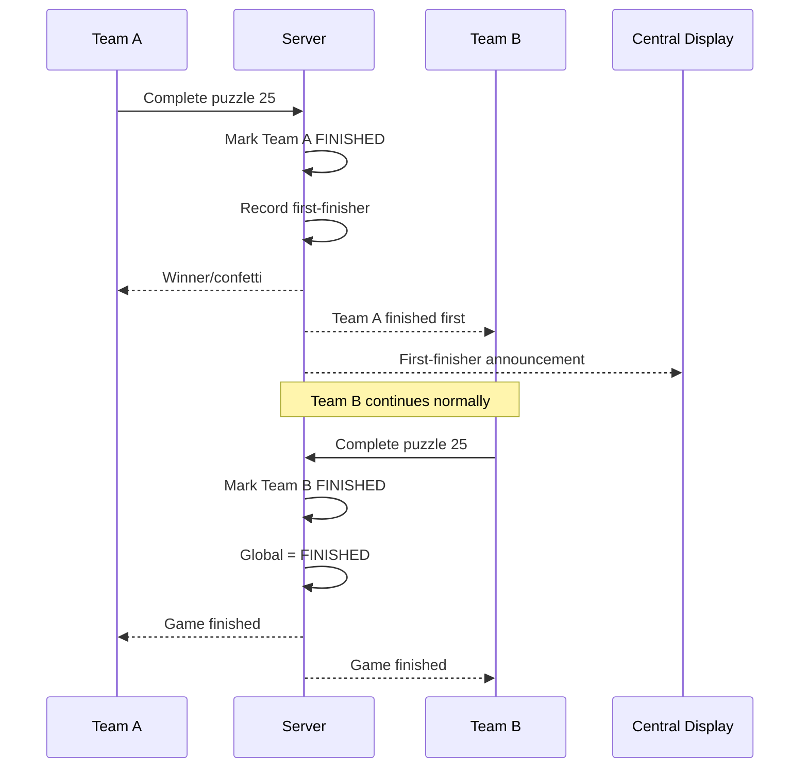

The first-finisher record is persistent.

Puzzle 25 completion in this sequence may come from a correct team answer or administrator force completion, but never from player Skip.

---

# 23. Hard invariants

## Global

1. Exactly one conceptual global state is active.
2. `READY` MAY be represented by the absence of an active run.
3. At most one active run exists.
4. `FINISHED` means both teams completed puzzle 25.
5. Music Quiz can trigger only once per game.
6. `PAUSED` preserves underlying team states.
7. `MUSIC_QUIZ` preserves underlying team states.
8. Gameplay timers do not advance during either interruption.
9. Restart/recovery does not create a new run or reload source configuration for an active run.
10. Full Reset leaves no active run and preserves the old run as history.

## Team

1. Team states are independent.
2. Normal progression requires all preceding puzzles to be completed.
3. Points cannot become negative.
4. At most one Freeze is active per team.
5. At most one Uno Reverse is active per team.
6. Each team has at most one Challenge opportunity per game.
7. Finished teams cannot perform normal gameplay actions.
8. Freeze is measured in Advent gameplay time.
9. Hint inventory is independent of puzzle progression.
10. Hints persist until consumed.
11. Uno Reverse persists until triggered/removed.
12. Fragments persist as team state.
13. Player Skip is illegal whenever the authoritative current puzzle is 25.

## Security

1. Team A cannot read Team B's private state.
2. Team A cannot modify Team B's private state.
3. Frontend manipulation cannot bypass authorization.
4. Progression is decided by the backend.
5. Relevant state changes are atomic.

---

# 24. Canonical backend action pipeline

All player actions should conceptually follow:

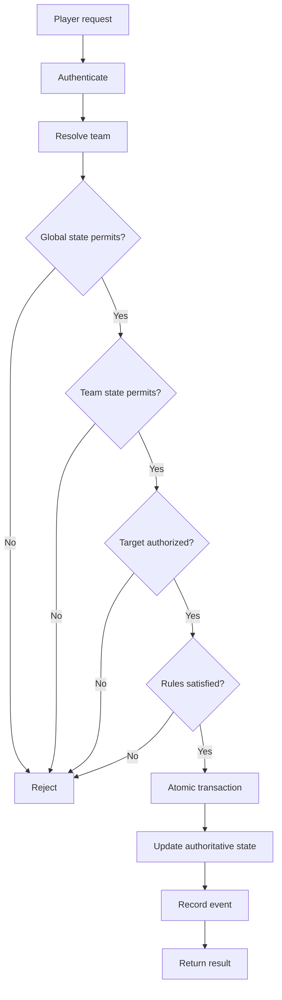

The frontend should request transitions; it should not decide whether transitions are legal.

---

# 25. Recommended transaction boundaries

### Puzzle completion

```text
Validate
→ mark completed
→ award configured reward
→ award fragments/effects
→ advance progression
→ evaluate global triggers
→ log
```

Player Skip validation MUST reject puzzle 25 before entering this completion sequence.

### Purchase

```text
Validate affordability
→ deduct points
→ grant item/effect
→ log
```

### Freeze

```text
Validate attacker/target
→ deduct cost
→ atomically resolve Uno Reverse
→ apply resulting Freeze
→ log
```

### Music Quiz answer

```text
Validate unresolved question
→ validate answer
→ resolve question
→ award points
→ advance question
→ log
```

### Challenge answer

```text
Validate active Challenge
→ validate answer
→ resolve winner
→ store outcome
→ apply outcome on Advent return
→ log
```

These boundaries are essential for simultaneous requests from the two teams.

---

# 26. Disconnect/reconnect

A disconnected device does not change game state.

The server remains authoritative.

On reconnect, the client retrieves current state and renders it.

A disconnect is never implicitly:

- a wrong answer;
- a Challenge loss;
- a resignation;
- a reset.

This applies during Freeze, Challenge and normal Advent gameplay.

The same principle applies to application/container/server recovery: process
restart is not implicitly a Reset. If an active run exists, the application
continues that run from persisted state and its pinned snapshot.

---

# 27. Implementation priority

The normal happy path should be robust before extensive emergency tooling.

### Highest priority

1. Persistent authoritative state model.
2. Global/team state machines.
3. Sequential progression.
4. Authentication and strict isolation.
5. Atomic transitions.
6. Canonical completion pipeline.
7. Persistent timer semantics.
8. Basic admin controls.
9. Automated tests for invariants/concurrency.

### Medium priority

10. Points.
11. Hints.
12. Skips.
13. Freeze.
14. Uno Reverse.
15. Music Quiz.
16. Challenge.
17. Fragments.
18. Event log.

### Low priority / emergency

19. Earlier-puzzle reopening.
20. Reopening finished teams.
21. Challenge cancellation.
22. Extensive unusual-state correction workflows.

Do not make the normal game architecture unnecessarily complicated to optimize for rare emergency scenarios.

---

# 28. Minimum critical tests

### Progression

- Correct answer advances.
- Wrong answer does not advance.
- Sequential prerequisites are enforced.
- Skip uses canonical completion on puzzles 1–24.
- Player Skip of puzzle 25 is rejected atomically with no cost/reward/progress/winner side effects.
- Stale/direct/reopened-final-puzzle Skip attempts cannot bypass the puzzle-25 rule.
- Admin force completion uses canonical completion, including puzzle 25.
- Completion rewards are configurable.
- Re-completion does not duplicate rewards/fragments.
- Puzzle 25 completes the team through a legal completion route.

### Global completion

- First team completing 25 becomes `FINISHED`.
- First team gets winner/confetti state.
- Other team continues.
- Finished team cannot perform normal actions.
- Global `FINISHED` waits for the second team.

### Music Quiz

- Puzzle 13 completion triggers it.
- Skip of 13 triggers it.
- Admin completion of 13 triggers it.
- It triggers only once.
- Underlying team states survive it.
- Freeze timers pause during it.
- A 60-second Music-clock gathering subphase precedes question 1.
- Pause freezes gathering and recovery does not restart it.
- First valid correct answer wins.
- Simultaneous correct answers resolve atomically.
- Configured points are awarded.
- Questions 2–11 advance immediately after the preceding winner.
- Active questions remain unlimited; the TV's three-minute bar is cosmetic.
- Advent gameplay resumes after the final result display.

### Freeze

- Cost is configurable.
- Insufficient points reject.
- Frozen teams cannot interact.
- Duration is 5 minutes of gameplay time.
- Pause/Music Quiz stop the timer.
- Admin removal returns immediately to `PUZZLE`.
- Finished teams cannot be frozen.
- A second Freeze cannot be applied while already frozen.

### Uno Reverse

- Hidden from opposing team.
- Reverses a valid Freeze.
- Reverse is consumed.
- Attacker still pays.
- Target is unaffected.
- Only one can be active.

### Challenge

- Each team can initiate once.
- Challenge costs **zero points**; only one opportunity per team is consumed atomically.
- Each team initiates a different puzzle; each individual Challenge shares one selected puzzle between both teams.
- The question/answers stay hidden during the **15-second gathering** phase.
- Frozen targets cannot be challenged.
- Cannot start during Pause/Music Quiz.
- Same puzzle for both teams.
- First valid correct answer wins.
- No Challenge points.
- Losing challenged team is frozen on Advent return.
- Disconnect does not cause loss.
- Cancellation restores the opportunity with **no points refund** (the original cost was zero).

### Security

- Team A cannot read Team B.
- Team A cannot modify Team B.
- URL manipulation cannot bypass isolation.
- API manipulation cannot bypass isolation.
- Frontend manipulation cannot bypass rules.

### Administration and lifecycle

- Start from `READY` requires/selects a valid package and creates a fresh run/snapshot.
- Merely listing packages does not create a snapshot/run.
- Invalid packages cannot be started and provide an administrator-visible diagnostic.
- Application/container restart with an active run preserves its run ID, state and pinned snapshot.
- Source package edits/deletion do not alter an active run.
- Full reset leaves no active run.
- Teams return to a waiting/`READY` projection after reset.
- Event log and old run history survive reset.
- Reset is logged.
- Old commands become stale after reset.
- Starting after reset creates a new run and observes the selected package's current source configuration.
- Two concurrent administrators cannot create competing active runs.
- Point changes are atomic and non-negative.
- Admin force completion follows canonical completion.
- Earlier reopen creates prerequisite violation without rollback.

---

# 29. Core implementation principle

> **Implement the game as an authoritative backend state machine with a frontend that renders state and requests transitions. Do not implement it as a collection of frontend screens with rules attached to buttons.**

For every action the backend should determine:

```text
Is the player authenticated?
Is this the correct team?
Is the global state compatible?
Is the team state compatible?
Are prerequisites satisfied?
Does the team have enough points?
Is the target valid?
Has another transaction already resolved this event?
What state transition occurs?
What rewards/effects/events are generated?
```

Only an accepted backend transition becomes visible as authoritative game state.
