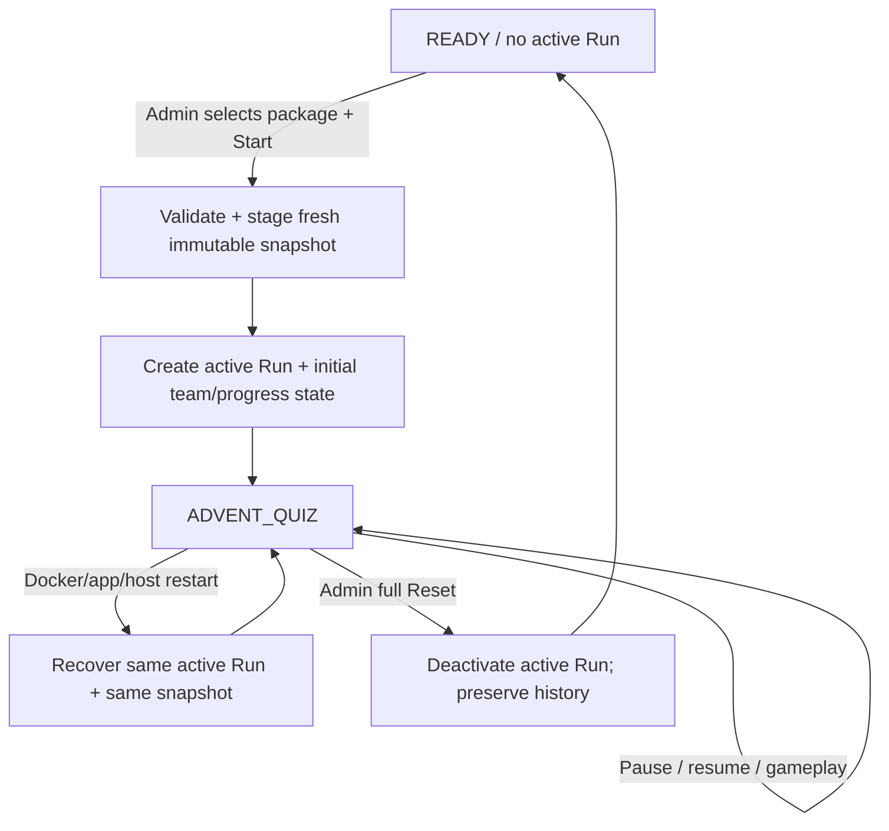

# Phase 3.1 game selection and run lifecycle contract

Status: implemented and validated for phase 3.1, 2026-09-23. Phase 4 has not
begun.

The normative game rules remain authoritative. This contract supersedes only the
Reset/READY/new-run lifecycle decisions recorded in the phase-2 and phase-3
contracts. It does not change phase-2 Hint/Skip/admin behavior or phase-3
gameplay-clock, Freeze, Uno Reverse, privacy, schema-v3, or downtime semantics.

## Product lifecycle

The application has two materially different situations:

1. **No active run (`READY`)** — no game package is pinned for play. Administrators
   choose a source package and teams wait for the game master.
2. **Active run** — all live state belongs to one durable `Run` and one immutable
   package snapshot.

`READY` is an application-level game state. It does not require an active
`Run(global_state="READY")` row.

A browser refresh, client disconnect, application restart, container restart,
host restart, or equivalent unexpected process recovery event is **not** a Reset
and must not cause source packages to be reloaded for an active run.

## Package discovery

The application exposes a read-only package-discovery operation for administrators.

Discovery:

- scans only direct package directories under the configured `games/` root;
- identifies packages by their package ID/directory according to the existing
  configuration rules;
- validates enough of each source package to determine whether Start can accept it;
- returns valid packages plus concise actionable diagnostics for invalid packages;
- does not create a `Run`;
- does not create or retain an immutable snapshot;
- does not alter source files;
- does not expose answers or other package-private content to team/public views.

Invalid packages are shown disabled/unavailable to administrators instead of being
silently hidden. Advanced authoring diagnostics/import/export remain phase 7.

Package discovery is a read operation and must not acquire the long-lived writer
transaction policy used by mutations.

## Start contract

Start is permitted only for an authenticated administrator and only when no active
run exists.

The administrator submits an explicit selected `package_id` and UUID
`request_id`. The existing Start idempotency contract remains: an exact retry of
a committed Start returns its original result; conflicting reuse of the same
request ID is rejected.

Start performs two stages:

1. **Pre-transaction staging**
   - resolve and validate the selected current source package;
   - create an immutable snapshot of `game.json` and every referenced media asset;
   - compute/verify its manifest/digest;
   - do not hold SQLite's writer slot while copying/verifying package files.

2. **Short authoritative transaction**
   - acquire the SQLite `IMMEDIATE` writer transaction;
   - recheck the authenticated administrator;
   - recheck Start receipt/idempotency;
   - recheck that no active run exists;
   - atomically create exactly one active run pinned to the staged snapshot;
   - initialize both teams, puzzle progress and all run-scoped phase-2/phase-3
     state from that snapshot;
   - initialize the phase-3 gameplay clock and enter `ADVENT_QUIZ`;
   - write the Start receipt/audit event and commit.

If another administrator wins a concurrent Start race, the losing staged snapshot
may be left unreferenced for later maintenance cleanup, but it must never become
active or affect the winning run.

Source package edits after Start must not affect the active run. Every active-run
configuration/media read uses the pinned immutable snapshot.

## Reset contract

Full Reset is an authenticated administrator mutation against the displayed
active `run_id`.

Reset:

- is allowed in the same global states supported by the existing admin Reset
  operation;
- acquires the normal SQLite `IMMEDIATE` mutation transaction;
- validates actor, request receipt and stale-run protection;
- reconciles any phase-3 clock/effect state as needed for a consistent final audit
  record;
- marks the current run inactive;
- writes the Reset audit event and receipt against the old run;
- preserves all historical database rows, attempts, rewards, fragments, balances,
  effect history, receipts and audit events belonging to the old run;
- preserves the old immutable snapshot on disk because it is part of the run's
  recoverable/auditable history;
- creates **no replacement Run**;
- creates no replacement `TeamRun`/`PuzzleProgress` rows;
- does not stage or select any source package.

After Reset commits, new commands carrying the old `run_id` are stale. State
queries render application `READY`; teams receive only the waiting projection and
administrators receive package discovery/game selection.

Reset should have an explicit confirmation in the admin UI because it ends the
current playable run.

## Recovery contract

When an active run exists, application/container/server startup performs no
game-selection behavior and does not reread source packages.

All projections and mutations continue from:

- the same active run ID;
- persisted team/progression/balance/inventory state;
- persisted phase-3 gameplay-clock state;
- persisted Freeze/Uno Reverse state;
- the same pinned immutable snapshot.

Phase-3 downtime semantics remain unchanged: if the persisted state was
`ADVENT_QUIZ`, unexpected downtime counts as Advent gameplay time; if it was
`PAUSED`, downtime does not count.

Deleting or editing the corresponding source directory under `games/` must not
break or alter recovery of an already-active run.

## READY projections

When no active run exists:

- the admin projection reports global `READY`, no `run_id`, no active package and
  a package-selection list/diagnostics;
- each team projection reports global/team `READY`, no `run_id`, no question,
  no points/inventory/effect values from a previous run, and no private media;
- the team UI displays a waiting-for-game-master state;
- the public/TV projection, when implemented, must not infer or expose historical
  team state.

A legacy active `READY` shell produced by the old phase-2/phase-3 Reset model is
not a valid steady state after phase 3.1.

## Legacy READY compatibility

The upgrade path must not require deleting `quiz.sqlite3` or wiping `var/`.

If phase 3.1 encounters the old implementation's active `READY` replacement run,
it must safely convert/retire that shell so the application reaches the new
no-active-run `READY` condition while preserving prior history.

The implementation may use either:

- a data migration that deactivates only legacy reset-created READY shells that
  can be identified safely; or
- a narrowly scoped, idempotent application/management compatibility operation.

The architect and persistence specialist must choose the safer approach after
inspecting the final phase-3 schema/audit facts. It must not accidentally
deactivate a genuinely active gameplay run.

After compatibility handling, the database invariant remains: **at most one
active run**, and phase-3.1 normal operation never keeps an active READY shell.

## Package/schema compatibility

Phase 3.1 does not introduce a new game-package schema version.

It uses the package schema and validator completed by phase 3, including schema
version 3 and its `freeze_cost` / `uno_reverse_cost` configuration where
applicable. Existing supported snapshot versions remain readable for historical
runs according to the phase-3 compatibility rules.

Package selection and discovery are generic across package IDs; no code path may
hard-code `christmas-2026-demo` as the only selectable game.

## Ownership

Before coding, the architect records exact final filenames after inspecting the
completed phase-3 branch. Default ownership is:

1. `architect`
   - `docs/phase-3.1-contract.md`
   - `quiz/application.py`
   - `quiz/contracts.py` if projections/contracts change
   - admin/team views, routes and templates
   - `docs/architecture.md`, `implementation_plan.md`, `USER.md`
2. `persistence_security`
   - `quiz/configuration.py` package discovery/validation support
   - models/migration only if required for safe legacy READY compatibility
   - focused storage/configuration tests
3. `test_invariants`
   - reset/start race tests
   - restart/snapshot-isolation regression tests
   - team waiting/privacy tests
   - browser coverage for package selection and Reset-to-READY
4. `game_engine`
   - no production changes expected unless inspection finds a genuinely pure
     lifecycle rule; phase-3 gameplay policies must not be reopened unnecessarily.

Shared files have one editor at a time. Phase 3.1 must preserve the completed
phase-3 behavior instead of refactoring it opportunistically.

## Acceptance gate

Phase 3.1 is complete only when all of the following are tested:

1. An active run survives application/container restart with the same run ID,
   pinned snapshot, progression, balances, gameplay clock, Freeze and Uno Reverse.
2. Source package edits/deletion cannot alter or break an active run.
3. Full Reset leaves no active run.
4. Reset preserves old run facts, receipts, audit history and snapshot, and logs
   the Reset.
5. Old-run commands after Reset are stale.
6. Team views show only a waiting state while no run exists and leak no previous
   run state.
7. Admin READY view lists all discoverable packages.
8. Invalid packages are not startable and expose an actionable administrator-only
   diagnostic.
9. Merely listing packages creates no immutable snapshot.
10. Start of a selected valid package creates a fresh immutable snapshot and a new
    run initialized from the package's current source contents.
11. Reset followed by editing a source package and starting it again observes the
    edited package through a different run/snapshot.
12. Two administrators racing to Start cannot create two active runs or duplicate
    initialization.
13. Legacy active READY shells from the old Reset implementation can be retired
    without deleting the database or affecting real active gameplay.
14. All completed phase-3 clock/Freeze/Reverse regression tests remain green.

No Music Quiz implementation, Challenge behavior, advanced package import/export,
or final package-authoring polish belongs to phase 3.1.

## Implementation record

Migration `0004_retire_legacy_ready_runs` is the selected compatibility path. It
idempotently deactivates only rows which are both active and in global `READY`;
it does not delete or rewrite their team, progress, receipt, audit, or snapshot
references, and it leaves active gameplay runs untouched.

The admin `READY` projection now carries read-only package status entries and an
optional root-discovery diagnostic. Start still uses `package_id` plus the
existing administrator-scoped UUID receipt contract. Reset receipts remain
attached to the archived old run, so exact retries return their committed result
while new commands against that inactive run are stale.
